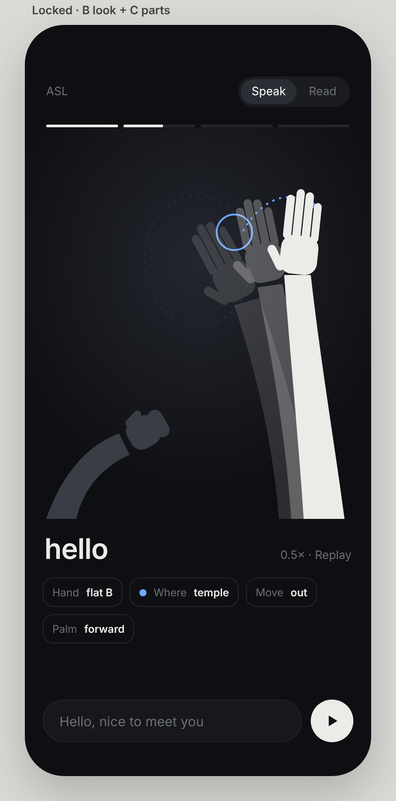

# Design (locked 2026-11-09)

J picked this from three sketches: the dark silhouette look ("B") with the sign-parts breakdown ("C"). Treat it as decided. Change it only when J asks.

## Look
- Dark and understated. The background is `#0e0f12`, with a soft radial glow behind the stage. The ink is `#ecebe8`, muted text `#6d6f76`, and there is one accent, `#6ea8fe`.
- No body or face. Show **arms and hands only**, as flat 2D silhouettes, not 3D models.
  - The dominant arm is light ink. The other arm is dim (`#3a3d45`).
  - A faint dashed head outline is the only location guide.
- Motion is shown with 2 ghost frames of earlier positions (14% and 28% opacity) and a dotted accent trail with an arrowhead.
- The location is marked by an accent ring at the place the sign happens (for example, the temple).

## Face (only when grammar needs it)
- Thin ink lines (brows, eyes, mouth) inside the dashed head guide, about 70% opacity, fading in over ~160 ms and out again.
- They show only while a non-manual marker is on: raised brows (yes/no question, topic, conditional, rhetorical), furrowed brows (WH-question), or a headshake (the features turn side to side, and the mouth turns down).
- The rest of the time, there is just the dashed guide.

## Layout (phone first)
1. Header: "ASL" on the left, and a Speak / Read segmented switch.
2. Sentence progress: one thin bar per sign, filling as each sign plays.
3. Stage: about 440 px tall, for the arms and hands.
4. The sign's word, large, in lowercase, with "0.5× · Replay" on the right.
5. Parts chips: **Hand** (shape), **Where** (an accent dot that matches the ring), **Move**, **Palm**. All of them come from `src/asl/lexicon.ts`, never written by hand.
6. Input bar: a text field and a round play button.

## Rules
- The lexicon stays the single source of truth for both drawing and chips. Every sign needs its parts fields.
- Keep the honesty footer (unreviewed signs, synthetic-data recognition).
